# 🏮 Willowmere — a cozy lakeside adventure

> Một xóm làng nhỏ ven hồ nơi ngọn hải đăng đã tắt suốt hai năm. Bạn là Quản lí
> mới — và cách duy nhất để thắp sáng ngọn đèn… là thắp sáng con người.
>
> *A warm little village RPG that runs entirely in your browser. No install,
> no server, no fail state — just small kindnesses, two endings, and one dark
> lighthouse waiting for a keeper.*

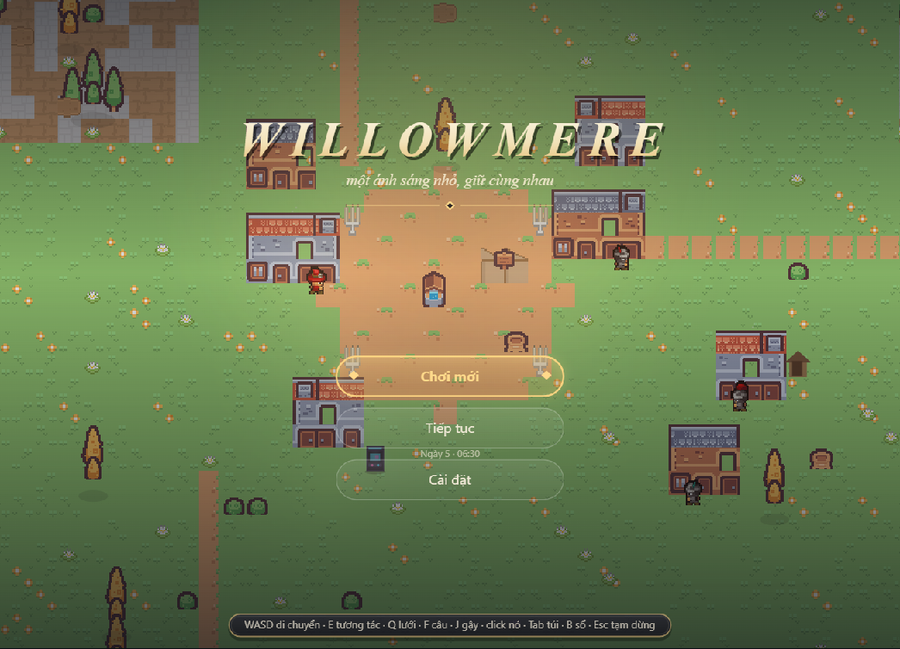

## ▶ Chơi ngay / Play

```bash
# Cách 1 — mở thẳng file (không cần gì thêm):
#   double-click willowmere/index.html

# Cách 2 — qua server tĩnh (khuyên dùng, để chơi được cả máy arcade):
#   chạy ở THƯ MỤC GỐC repo (arcade nạp ../neon-swarm/ bên ngoài willowmere/)
python -m http.server 8940
# rồi mở http://127.0.0.1:8940/willowmere/index.html
```

Lưu ý: game chạy hoàn toàn từ `file://` — không build, không npm, không mạng.
Một slot save tự động qua `localStorage`.

## Trò chơi có gì

| | |
|---|---|
| 🏘 **Một ngôi làng sống** | 8 dân làng có tên, lịch trình theo giờ, tự trò chuyện với nhau — đứng lại gần để nghe |
| 📜 **9 nhiệm vụ** | 1 tuyến chính + 8 nhánh, mỗi nhánh **hai hướng kết** do bạn chọn |
| 🎣 **Câu cá 3 nhịp** | thả phao → giật khi cắn → giữ thanh timing; cá hiếm theo giờ/thời tiết (Cá Vua Liễu chỉ cắn ngày mưa) |
| 🦋 **Thu thập** | lưới bắt côn trùng, nỏ cao su, sổ tay ghi lại 18 loài + 5 điểm ngắm cảnh |
| ⛵ **Thuyền** | ra khơi hồ — cá nước sâu chỉ câu được từ mạn thuyền |
| 🌦 **Thời gian sống** | ngày ~8 phút, mưa nắng theo ngày, đom đóm và moonbell ban đêm |
| 🌄 **5 vista** | bước vào điểm ngắm — camera zoom-out như tấm bưu thiếp |
| ⚔ **Sinh vật đêm** | wisp và cua vũ đêm — gậy gỗ, knockback, screen-shake |
| 💾 **Save/Load đầy đủ** | ngủ qua đêm hoặc nút Save; autosave khi ẩn tab |
| 🕹 **Neon Swarm** | máy arcade nhúng trong game — twin-stick shooter nguyên bản, `Esc` về làng |

## Hình ảnh

| Quảng trường buổi sáng | Câu cá ở bến | Đêm đom đóm |
|---|---|---|
| 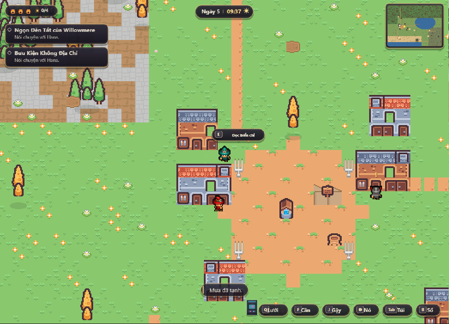 | 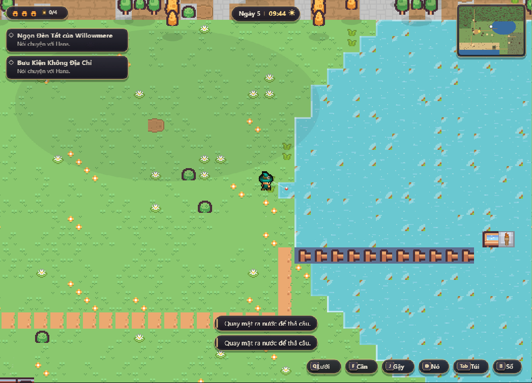 | 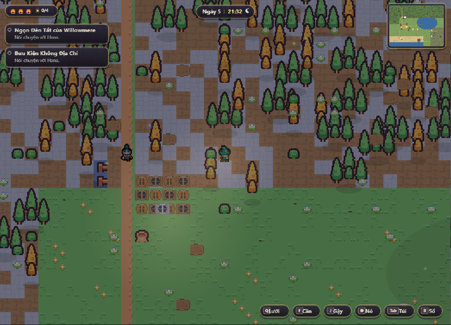 |

| Mưa tràn vào làng | Hội thoại cùng Gideon | Sổ tay sưu tầm |
|---|---|---|
| 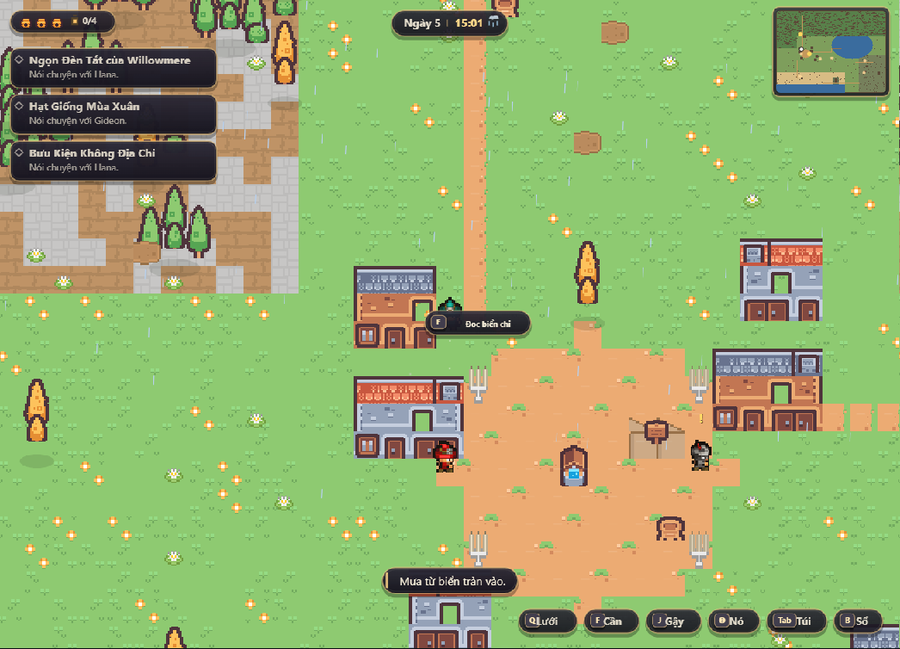 | 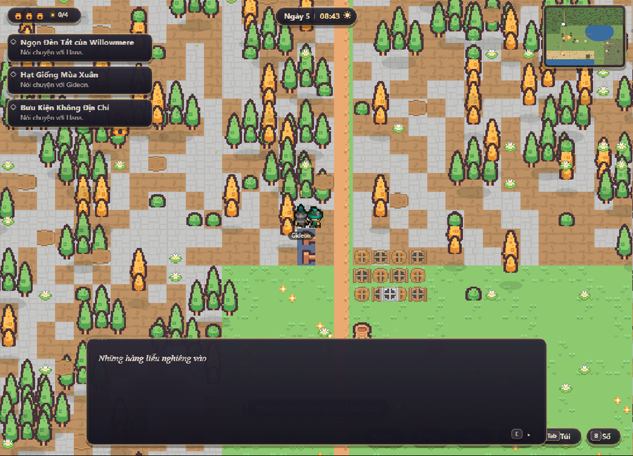 | 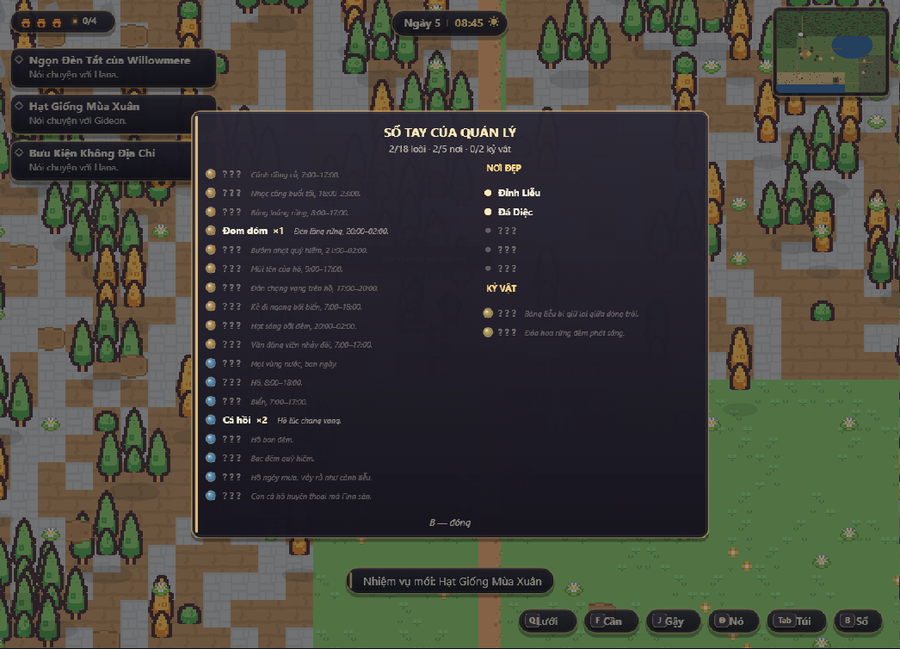 |

| Vista panorama | Máy arcade Neon Swarm |
|---|---|
| 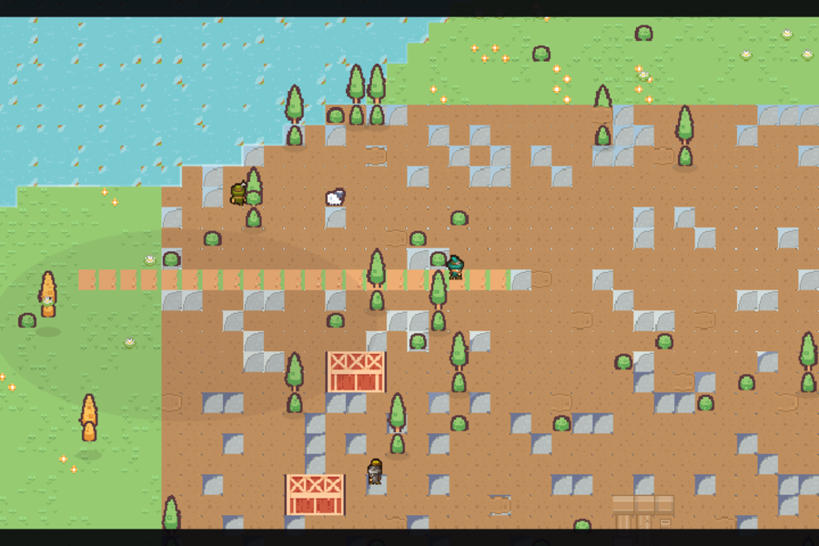 | 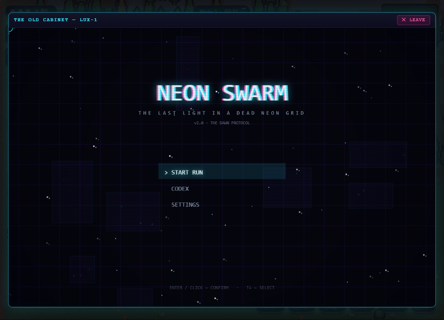 |

## Gameplay

**Đi dạo qua làng** — NPC theo lịch riêng, name-tag và tim thiện cảm hiện khi lại gần:

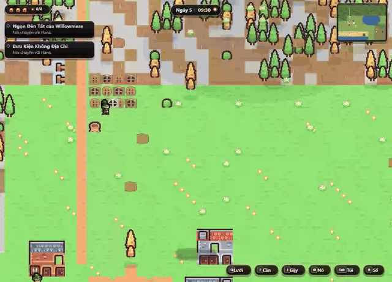

**Câu cá** — thả phao, chờ "!", rồi giữ thanh timing cho cá vào band xanh (con này… tuột mất rồi):

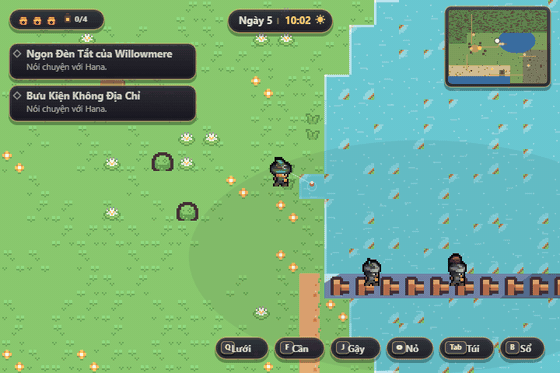

**Điểm ngắm cảnh** — bước tới gần, camera tự kéo ra letterbox panorama:

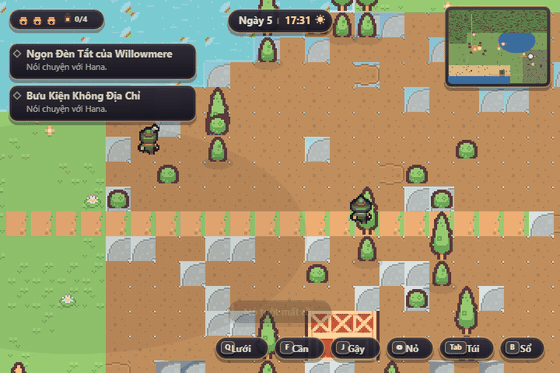

## Điều khiển

| Phím | Việc |
|---|---|
| `WASD` / mũi tên | Di chuyển |
| `E` / `Enter` / `Space` | Tương tác · nói chuyện · tặng quà · xác nhận |
| `Q` | Vung lưới |
| `F` | Câu cá (3 nhịp) |
| `J` | Vung gậy (đuổi wisp/cua đêm) |
| Chuột | Nỏ cao su — ngắm + click |
| `Tab` | Túi đồ |
| `B` | Sổ tay sưu tầm |
| `Esc` / `P` | Pause · quay lại |

## Cấu trúc repo

```
willowmere/        game chính — vanilla JS + Canvas 2D, 13 script gắn window.*
  js/              world · npcs · dialogue · story · action · hud · audio · main
  assets/          art + nhạc CC0 (Kenney, OpenGameArt — credit trong README)
  tools/           check_contract · check_dialogue · smoke_render (node)
  DESIGN.md        tài liệu thiết kế đầy đủ
neon-swarm/        Neon Swarm — arcade shooter nhúng qua iframe
docs/media/        ảnh + GIF dùng trong README này
```

## Kiểm chứng

```bash
cd willowmere
node tools/check_contract.js   # kiểm tra API cross-file
node tools/check_dialogue.js   # nhất quán hội thoại/quest
node tools/smoke_render.js     # render smoke (headless)
cd ../neon-swarm && node tools/smoke_render.js
```

Đã verify bằng tay trong trình duyệt: save→reload→continue khớp từng field,
ngủ qua đêm roll mưa đúng 06:00, quest arc `parcel` chạy trọn tới diều trên
mái nhà, thuyền ra khơi + câu cá biển, lampLit chặn spawn wisp cả hai chiều,
arcade Esc relay chặn message giả — console sạch 0 errors.

## Giấy phép & credit

Code phát hành theo [MIT](LICENSE). Art/nhạc trong `willowmere/assets/` là
tài nguyên **CC0** — bảng credit chi tiết từng file trong
[`willowmere/README.md`](willowmere/README.md).
